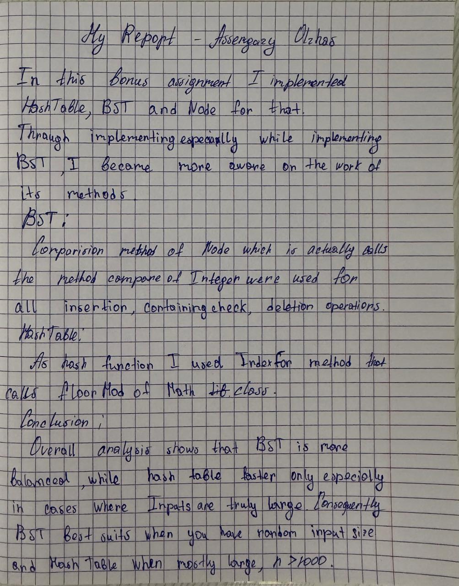

# Handwritten Report


# BST and hash table

This project compares a binary search tree and a hash table. Both store integer values and support adding, finding, and removing values. They reject duplicate values.

## Run the benchmark

From the project folder, compile and run:

```sh
javac -d out src/*.java
java -cp out Benchmark
```

The program writes the results to `results.csv`.

## How the operations work

In the BST, each value smaller than a node goes to its left side, and each larger value goes to its right side. Search follows these comparisons. Delete handles a node with no children, one child, or two children.

The hash table turns each value into a bucket number. Each bucket is a linked list, so more than one value can fit in a bucket if they get the same number. The table uses a fixed number of buckets and does not resize itself.

## Time complexity

Here, `n` means the number of stored values. The O notation describes how the work grows as more values are stored. O(1) means the work stays about the same; O(log n) means the search follows a tree that gets taller slowly; O(n) means it may check many or all values.

| Operation | BST best | BST typical | BST worst | Hash table best | Hash table typical | Hash table worst |
| --- | --- | --- | --- | --- | --- | --- |
| Insert | O(1) | O(log n) | O(n) | O(1) | O(1) | O(n) |
| Search | O(1) | O(log n) | O(n) | O(1) | O(1) | O(n) |
| Delete | O(1) | O(log n) | O(n) | O(1) | O(1) | O(n) |

The BST's typical time assumes values arrive in an order that keeps the tree fairly balanced. If values arrive in sorted order, the tree can become a long chain, and operations can take O(n). The hash table's typical time assumes it has enough buckets and values spread across them. If many values land in one bucket, an operation may have to scan that bucket and take O(n). This hash table does not resize, so adding many values to a small table can make its buckets longer.

## Benchmark results

Each table entry is the median time in milliseconds for a whole batch of operations on that many values. Search checks all inserted values, and deletion removes all of them. The program runs two warm-up rounds and then records seven rounds.

| Values | BST insert | BST search | BST delete | Hash insert | Hash search | Hash delete |
| ---: | ---: | ---: | ---: | ---: | ---: | ---: |
| 100 | 0.012917 | 0.011709 | 0.019917 | 0.026500 | 0.014584 | 0.024125 |
| 1,000 | 0.105417 | 0.107500 | 0.147208 | 0.087208 | 0.080833 | 0.083167 |
| 10,000 | 0.828459 | 0.861042 | 1.491333 | 0.182416 | 0.190208 | 0.112375 |

For 100 values, the BST was faster in these measurements. At 1,000 and 10,000 values, the hash table was faster for all three operations. Times can change on another computer or another run.

The benchmark uses values from 0 to `n - 1` and gives the hash table `2n + 1` buckets. This means these values go into separate buckets, so the run does not show how collisions affect the hash table. The hash table can also get slower if the bucket lists grow. The BST's time can change if its shape changes. These details, along with the computer and Java runtime, affect measured times.

## Conclusion

The hash table was faster for the larger inputs in this run. Its fast results came from having plenty of buckets for these particular values. The BST stayed reasonably balanced because the benchmark shuffled the values before inserting them. The results show one workload, changing the input order or causing more collisions could change the comparison.